<div align="center">



<a href="https://readme-typing-svg.demolab.com">
  
</a>

<br/><br/>

<a href="https://linkedin.com/in/adrian-peiris-004728209"></a>
<a href="mailto:adrianpeiris14@gmail.com"></a>
<a href="https://leetcode.com/adrianpeiris14"></a>
<a href="https://github.com/adrianpeiris"></a>

</div>

---

## 

```yaml
name: Adrian Peiris
background: Computer Science
currently: Postgraduate AI Student
based_in: Kyoto, Japan
japanese: JLPT N3 (intermediate)
interests: [Software Engineering, AI, Full-Stack, Backend Architecture]
```

I'm a Computer Science graduate pursuing postgraduate studies in Artificial Intelligence in Kyoto, Japan. I enjoy designing and building practical software, exploring how systems work under the hood, and applying new technologies to solve real problems.

My experience spans full-stack development, application support, database-backed systems and collaborative software projects.

## 

<div align="center">

**LANGUAGES**


**FRONTEND & BACKEND**


**DATABASES & TOOLS**


</div>

## 

I'm continuously expanding my toolkit and exploring technologies used in modern software and AI engineering. These are learning interests, not a claim of professional proficiency.

<div align="center">

**PROGRAMMING LANGUAGES**


**MODERN FRAMEWORKS & BACKEND**


**DATABASES, CLOUD & DEVOPS**


**AI & MACHINE LEARNING**


</div>

- **AI ecosystem:** Hugging Face, LangChain and Jupyter
- **Cloud-native development:** Docker, Kubernetes, CI/CD and infrastructure as code
- **Modern full-stack:** TypeScript, Next.js and API development

## 

<div align="center">


</div>

- Artificial Intelligence and Machine Learning
- Full-stack application development
- Backend systems and database architecture
- Android application development

---

<div align="center">


### LET'S CONNECT

<a href="https://linkedin.com/in/adrian-peiris-004728209"></a>
<a href="mailto:adrianpeiris14@gmail.com"></a>
<a href="https://instagram.com/adrian.peiris"></a>
<a href="https://x.com/adrian_peiris"></a>
<a href="https://www.youtube.com/@adrianpeiris01"></a>

<br/><br/>

<a href="mailto:adrianpeiris14@gmail.com">adrianpeiris14@gmail.com</a>



<sub>ADRIAN PEIRIS · 2026</sub>

</div>
